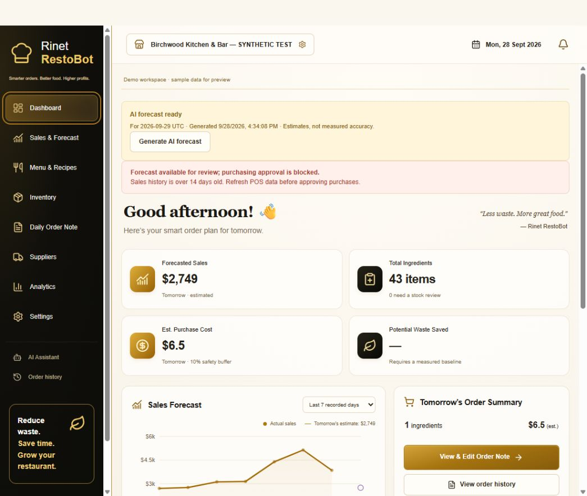
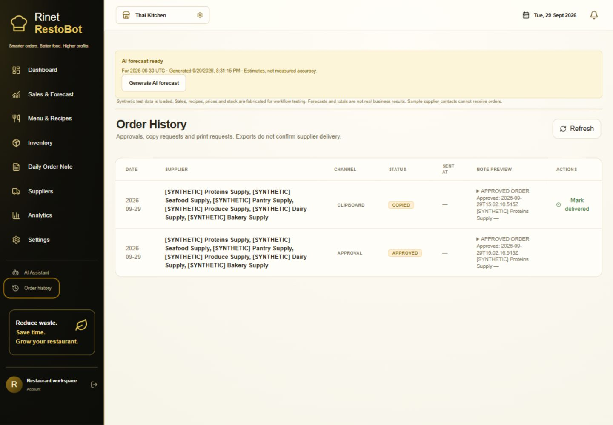

<div align="center">

# RestoBot

### AI powered food waste reduction and restaurant planning

Created by **Ridith S. Shetty** · India Book of Records application: **Youngest Creator of AI for Restaurant Food Waste Management**

[Features](#what-restobot-does) · [Screenshots](#product-screenshots) · [Setup](#run-locally) · [Deploy](#deploy-on-render)

</div>

RestoBot brings restaurant sales, recipes, inventory, waste tracking, and purchasing into one workspace. It helps a restaurant estimate what it may need for an upcoming service, account for stock already on hand, and prepare an order note for a person to review.

> **About the screenshots:** The included product captures use clearly labelled synthetic demonstration data. They show interface workflows and charts, not real restaurant results, measured savings, or forecast accuracy.

## What RestoBot does

- **Demand planning:** builds sales forecasts from recorded history and presents estimates for review.
- **Recipe linked inventory:** connects menu dishes to ingredients, quantities, stock levels, and costs.
- **Waste tracking:** records discarded ingredients, quantities, and reasons for later analysis.
- **Purchasing support:** estimates ingredient requirements after considering recipes and available stock.
- **Order review:** prepares editable order notes and keeps a history of saved drafts and approvals. It does not automatically send orders to suppliers.
- **Graphs and reports:** visualizes sales history, forecasts, stock, waste, and restaurant performance.
- **Optional AI assistance:** server side AI requests are disabled by default and require explicit configuration. Deterministic workflows remain available when AI is off.
- **Restaurant account security:** Supabase Auth and tenant scoped database policies protect restaurant workspace data.

## Product screenshots

### 1. Restaurant dashboard and sales graph



This capture shows the main workspace: navigation to sales, recipes, inventory and the daily order note; an explicit synthetic-data notice; a sales history chart; high level forecast and inventory cards; and a link into the editable order workflow. The forecast shown is an estimate for demonstration and is not a measured accuracy result.

### 2. Order history and saved drafts



This screen shows saved order history entries, including the supplier label, channel, approval or copy status, and note preview. Supplier names and contacts in this demo are synthetic. A saved, copied, or approved note does not confirm that an order was delivered.

## Typical workflow

1. Record or import sales history.
2. Maintain menu recipes and ingredient quantities.
3. Update inventory, costs, and supplier catalogue details.
4. Review forecast estimates and the related sales graph.
5. Inspect the proposed ingredient quantities and edit the daily order note.
6. Review and approve the order note before independently contacting a supplier.
7. Log waste and review reports as operational records accumulate.

## Technology

- React 19, TypeScript, and Vite
- Express and Node.js
- Supabase Auth and PostgreSQL
- Recharts

## Run locally

Requirements: Node.js 20 or newer, npm, and a Supabase project with the included database migrations applied.

```bash
npm install
copy .env.example .env.local
npm run dev
```

Open `http://localhost:3000`.

Set the required values in `.env.local`: `SUPABASE_URL`, `SUPABASE_ANON_KEY`, `SUPABASE_SERVICE_ROLE_KEY`, `VITE_SUPABASE_URL`, `VITE_SUPABASE_ANON_KEY`, and `RESTOBOT_RESTAURANT_ID`. Use a server only secret for the service role key. Never add `.env.local` or secret values to Git.

Public account creation, optional AI calls, and automated scheduling are disabled by default. Do not enable them until their production behavior and access controls have been reviewed.

## Database setup

Apply the SQL files in `supabase/migrations` in numerical order. The migrations define restaurant profiles, menu items, ingredients, recipes, sales, forecasts, waste entries, suppliers, order notes, row level security, and atomic workflow functions.

## Build and tests

```bash
npm test
npm run build
```

The Express server exposes `/healthz` for deployment health checks.

## Deploy on Render

The repository includes [`render.yaml`](render.yaml) with the Node web service build, start, health check, and safe default configuration.

1. In Render, create a **Blueprint** from `RockingRidz/RestoBot`.
2. Review the service settings from `render.yaml`.
3. Enter Supabase URL, anonymous key, and service role key in Render's private environment settings when prompted. The service role key must remain server only.
4. Deploy and wait for `/healthz` to pass.
5. Add the deployed Render URL to Supabase Auth's allowed redirect URLs.
6. Test login and verify the dashboard, graphs, recipes, inventory, waste records, and order history.

The blueprint keeps public signup, AI calls, and automated scheduling disabled. Supplier delivery is not automated; purchase notes require human review.

## Demo data and limitations

Synthetic fixtures exist for repeatable workflow and chart demonstrations. They must not be represented as actual restaurant transactions, measured waste reductions, proven savings, or forecast validation. Product screenshots above are illustrative captures of the application and its demo content.

## Security notes

- `.gitignore` excludes local environment files, keys, certificates, database dumps, and build output.
- Never put Supabase service role keys or AI provider keys in browser variables or source files.
- Keep reviewer credentials private and share them only through the intended review channel.
- Restaurant users should check all forecasts and purchase suggestions before acting on them.

## Creator

Designed and developed by **Ridith S. Shetty**.

RestoBot helps restaurants plan purchasing with sales, recipes, and current stock in view.
